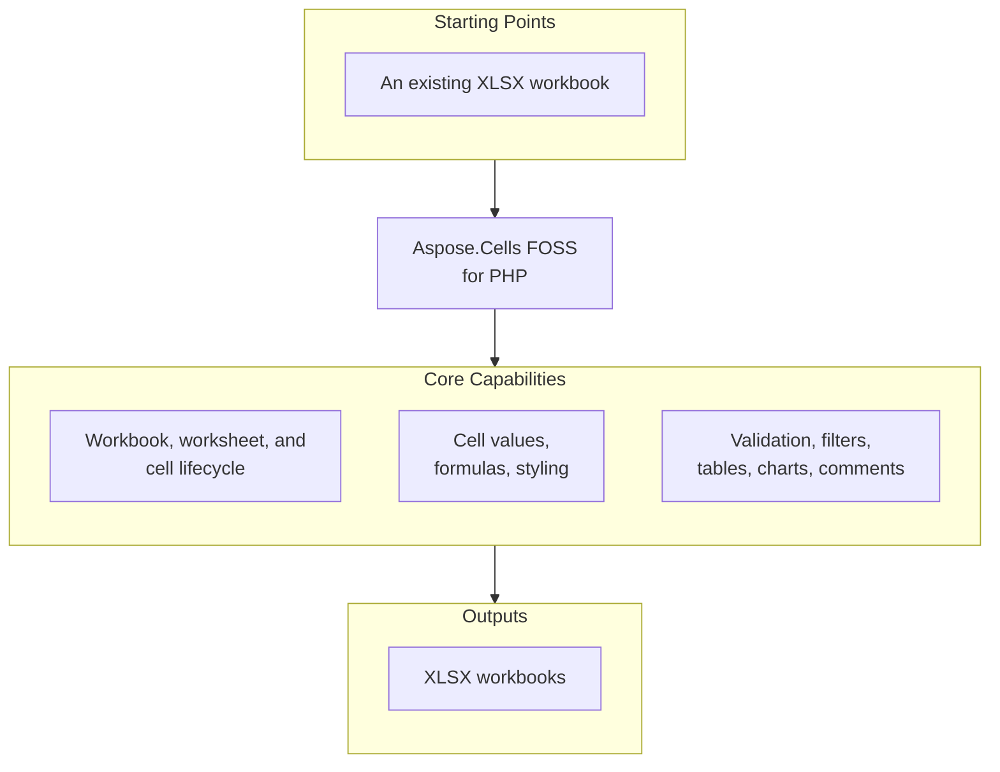

# Aspose.Cells FOSS for PHP

[](License/LICENSE.txt) [](https://www.php.net/) [](https://github.com/aspose-cells-foss/Aspose.Cells-FOSS-for-PHP/graphs/contributors)

[](https://products.aspose.org/cells/php/)

Aspose.Cells FOSS for PHP is a free, open-source, MIT-licensed PHP library for creating, loading, editing, and saving Excel `.xlsx` workbooks, with no dependency on Microsoft Excel or any native Office installation. It exposes an Aspose.Cells-style API surface built around `Workbook`, `Worksheet`, `Cells`, and `Cell`, and is a faithful port of the C# `aspose-cells-foss-for-net` sources. It runs on Windows, Linux, and macOS.

## Navigation

- [At a Glance](#at-a-glance)
- [Key Capabilities](#key-capabilities)
- [Installation](#installation)
- [Dependencies](#dependencies)
- [Quick Start](#quick-start)
- [Additional Examples](#additional-examples)
- [API Reference](#api-reference)
- [Documentation & Resources](#documentation--resources)
- [Scope and Limitations](#scope-and-limitations)
- [Development and Testing](#development-and-testing)
- [License](#license)

## At a Glance



## Key Capabilities

- Create a new workbook or load an existing `.xlsx` file with `new Workbook()` / `new Workbook($fileName)` / `new Workbook($stream)`, then save back to `.xlsx` through `Save(...)`; navigate sheets through `Workbook->Worksheets`.
- Recover from malformed input instead of failing outright: `LoadOptions->TryRepairPackage`, `TryRepairXml`, and `StrictMode` control repair behavior, and `LoadDiagnostics` reports repair and data-loss-risk diagnostics through `HasRepairs` and `HasDataLossRisk`.
- Read and write cell values of multiple types (strings, numbers, booleans, dates) with `Cell->PutValue($value)`, and read them back with `Cell->StringValue` / `Cell->Value`; store formulas as strings via `Cell->Formula`.
- Apply fonts, fills, borders, alignment, number formats, and wrapping through `Cell->GetStyle()` / `SetStyle()` and the `Style`, `Font`, `Borders`, and `FillPattern` types.
- Configure worksheet-level display settings including visibility, gridlines, and page setup through `Worksheet->PageSetup`, plus workbook and document metadata via `WorkbookProperties` and `CoreDocumentProperties`.
- Add list, decimal, and custom validation rules with `ValidationCollection->Add()`, `ValidationType`, and `OperatorType`; highlight data with conditional formatting via `Worksheet->ConditionalFormattings`; filter columns with `AutoFilter` / `FilterColumn`.
- Add hyperlinks through `HyperlinkCollection->Add()`; create workbook-level and sheet-scoped defined names with `DefinedNameCollection->Add()`.
- Build structured Excel tables through `Worksheet->ListObjects`, including built-in table styles (`TableStyleType`) and totals-row aggregation (`TotalsCalculation`); anchor pictures (`PictureCollection`) and drawing shapes (`ShapeCollection`, `AutoShapeType`) to a worksheet.
- Create and configure charts through `ChartCollection->Add()` and `Chart` / `ChartType`; attach legacy cell comments with `CommentCollection->Add()`.

## Installation

```bash
git clone https://github.com/aspose-cells-foss/Aspose.Cells-FOSS-for-PHP.git
cd Aspose.Cells-FOSS-for-PHP
```

The library uses PSR-4 autoloading under the `Aspose\Cells_FOSS\` namespace, provided by the bundled bootstrap autoloader at `autoload.php` — require it once from your own entry-point script: `require __DIR__ . '/autoload.php';` (adjust the relative path if your script lives outside the repository root). The public namespace is `Aspose\Cells_FOSS` (with an underscore).

## Dependencies

### Required Package Dependencies

No required third-party package dependencies.

### Native and System Requirements

- PHP 8.1 or later.
- The `zip` extension — the XLSX container is a ZIP package; `src/Internal/Io/ZipArchive.php` and the XLSX workbook serializer/loader classes depend on it directly.
- The `dom` extension — `src/Internal/Xml/XDocument.php`'s internal XML shim constructs `\DOMDocument`/`\DOMElement` instances to parse and build the package's XML parts.

## Quick Start

```php
<?php

use Aspose\Cells_FOSS\Color;
use Aspose\Cells_FOSS\FillPattern;
use Aspose\Cells_FOSS\Workbook;

$workbook = new Workbook();
$sheet = $workbook->Worksheets[0];

$sheet->Name = 'Products';
$sheet->Cells['A1']->PutValue('Product');
$sheet->Cells['B1']->PutValue('Price');
$sheet->Cells['A2']->PutValue('Apple');
$sheet->Cells['B2']->PutValue(2.99);
$sheet->Cells['A3']->PutValue('Orange');
$sheet->Cells['B3']->PutValue(1.99);
$sheet->Cells['B4']->Formula = '=SUM(B2:B3)';

$headerStyle = $sheet->Cells['A1']->GetStyle();
$headerStyle->Font->IsBold = true;
$headerStyle->Font->Color = Color::FromArgb(255, 255, 255, 255);
$headerStyle->Pattern = FillPattern::Solid;
$headerStyle->ForegroundColor = Color::FromArgb(255, 34, 120, 212);

$sheet->Cells['A1']->SetStyle($headerStyle);
$sheet->Cells['B1']->SetStyle($headerStyle);

$workbook->Save('products.xlsx');
```

Load an existing workbook with repair-friendly options:

```php
<?php

use Aspose\Cells_FOSS\LoadOptions;
use Aspose\Cells_FOSS\Workbook;

// An existing workbook to load -- any real .xlsx file works here.
(new Workbook())->Save('products.xlsx');

$loadOptions = new LoadOptions();
$loadOptions->TryRepairPackage = true;
$loadOptions->TryRepairXml = true;
$loadOptions->StrictMode = false;

$workbook = new Workbook('products.xlsx', $loadOptions);

if ($workbook->LoadDiagnostics->HasDataLossRisk) {
    echo 'Potential data loss risk detected during load.' . PHP_EOL;
}

$workbook->Worksheets[0]->Cells['A1']->PutValue('Updated');
$workbook->Save('updated.xlsx');
```

## Additional Examples

Runnable samples live under [`samples/`](samples/README.md); feature areas currently covered there include basic workbook and cell operations, load and repair behavior, styles, worksheet settings, validations, conditional formatting, hyperlinks and defined names, page setup, comments, charts, list objects, pictures, document properties, and shapes. More runnable snippets adapted from those samples are collected below.

### Build a Table With Totals

```php
<?php

use Aspose\Cells_FOSS\TableStyleType;
use Aspose\Cells_FOSS\Workbook;

$workbook = new Workbook();
$sheet = $workbook->Worksheets[0];

$sheet->Cells['A1']->PutValue('Product');
$sheet->Cells['B1']->PutValue('Category');
$sheet->Cells['C1']->PutValue('Price');
$sheet->Cells['A2']->PutValue('Laptop');
$sheet->Cells['B2']->PutValue('Electronics');
$sheet->Cells['C2']->PutValue(999.99);
$sheet->Cells['A3']->PutValue('Mouse');
$sheet->Cells['B3']->PutValue('Electronics');
$sheet->Cells['C3']->PutValue(29.99);

$tableIndex = $sheet->ListObjects->Add('A1', 'C3', true);
$table = $sheet->ListObjects[$tableIndex];
$table->DisplayName = 'Products';
$table->TableStyleType = TableStyleType::TableStyleMedium2;
$table->ShowTotals = true;

$workbook->Save('products-table.xlsx');
```

<details>
<summary>View Additional Examples</summary>

### Highlight Data With Conditional Formatting

```php
<?php

use Aspose\Cells_FOSS\CellArea;
use Aspose\Cells_FOSS\Color;
use Aspose\Cells_FOSS\FillPattern;
use Aspose\Cells_FOSS\FormatConditionType;
use Aspose\Cells_FOSS\OperatorType;
use Aspose\Cells_FOSS\Workbook;

$workbook = new Workbook();
$sheet = $workbook->Worksheets[0];

for ($index = 0; $index < 10; $index++) {
    $sheet->Cells[[$index, 0]]->PutValue($index + 1);
}

$rules = $sheet->ConditionalFormattings[$sheet->ConditionalFormattings->Add()];
$rules->AddArea(CellArea::CreateCellArea('A1', 'A10'));
$rule = $rules[$rules->AddCondition(FormatConditionType::CellValue, OperatorType::Between, '3', '7')];
$rule->Style->Pattern = FillPattern::Solid;
$rule->Style->ForegroundColor = Color::FromArgb(255, 255, 199, 206);

$workbook->Save('conditional-formatting-sample.xlsx');
```

### Add Hyperlinks and Named Ranges

```php
<?php

use Aspose\Cells_FOSS\Workbook;

$workbook = new Workbook();
$sheet = $workbook->Worksheets[0];

$sheet->Cells['A1']->PutValue('Docs');
$link = $sheet->Hyperlinks[$sheet->Hyperlinks->Add('A1', 1, 1, 'https://example.com/docs')];
$link->TextToDisplay = 'Docs';

$name = $workbook->DefinedNames[$workbook->DefinedNames->Add('GlobalRange', "='Sheet1'!\$A\$1:\$D\$5")];

$workbook->Save('hyperlinks-and-names-sample.xlsx');
```

### Create a Chart

```php
<?php

use Aspose\Cells_FOSS\ChartType;
use Aspose\Cells_FOSS\Workbook;

$workbook = new Workbook();
$sheet = $workbook->Worksheets[0];
$sheet->Name = 'Charts';

for ($month = 1; $month <= 12; $month++) {
    $sheet->Cells[[$month, 0]]->PutValue('Month ' . $month);
    $sheet->Cells[[$month, 1]]->PutValue($month * 1000);
}

$chartIndex = $sheet->Charts->Add(ChartType::Column, 'Charts!$B$1:$B$13', 0, 4, 18, 8);
$chart = $sheet->Charts[$chartIndex];

$workbook->Save('charts-sample.xlsx');
```

</details>

## API Reference

The public API is exposed under the `Aspose\Cells_FOSS` namespace, with `Workbook` as the root object and `Worksheet`, `Cells`, and `Cell` as the types most developers interact with day to day. The tables below summarize the supported public surface present in this checkout, grouped exactly as [reference.aspose.org](https://reference.aspose.org/cells/php/) groups them.

<details>
<summary>View the Supported Public API Surface</summary>

### Core API

| Class / Interface | Description |
|---|---|
| `AlignmentValue` | `AlignmentValue` is a class in Aspose.Cells FOSS for Php exposing `Clone`, `__construct`. |
| `AutoFilter` | `AutoFilter` is a class in Aspose.Cells FOSS for Php exposing `Clear`, `__construct`, `__get`, `__set`. |
| `AutoFilterColorFilter` | AutoFilterColorFilter.Clear() clears any color‑based filter criteria applied to an auto‑filter column. |
| `AutoFilterColorFilterModel` | `AutoFilterColorFilterModel` is a class in Aspose.Cells FOSS for Php exposing `Clear`. |
| `AutoFilterCustomFilter` | `AutoFilterCustomFilter` is a class in Aspose.Cells FOSS for Php exposing `__construct`, `__get`, `__set`. |
| `AutoFilterCustomFilterCollection` | `AutoFilterCustomFilterCollection` is a class in Aspose.Cells FOSS for Php exposing `Add`, `Clear`, `GetEnumerator`, `RemoveAt`, `__construct`, `__get`, and 7 more. |
| `AutoFilterCustomFilterModel` | `AutoFilterCustomFilterModel` is a class in Aspose.Cells FOSS for Php exposing the `Operator`, `Value` properties. |
| `AutoFilterDynamicFilter` | `AutoFilterDynamicFilter` is a class in Aspose.Cells FOSS for Php exposing `Clear`, `__construct`, `__get`, `__set`. |
| `AutoFilterDynamicFilterModel` | AutoFilterDynamicFilterModel lets developers enable a dynamic filter, choose its type, and set single or range values via the Enabled, Type, Value, and MaxValue properties. |
| `AutoFilterModel` | `AutoFilterModel` is a class in Aspose.Cells FOSS for Php exposing `Clear`, `HasStoredState`, `__construct`. |
| `AutoFilterSortCondition` | `AutoFilterSortCondition` is a class in Aspose.Cells FOSS for Php exposing `__construct`, `__get`, `__set`. |
| `AutoFilterSortConditionCollection` | `AutoFilterSortConditionCollection` is a class in Aspose.Cells FOSS for Php exposing `Add`, `Clear`, `GetEnumerator`, `RemoveAt`, `__construct`, `__get`, and 7 more. |
| `AutoFilterSortConditionModel` | `AutoFilterSortConditionModel` is a class in Aspose.Cells FOSS for Php exposing the `CustomList`, `Descending`, `DifferentialStyleId`, `IconId`, `IconSet`, `Ref`, and 1 more properties. |
| `AutoFilterSortState` | AutoFilterSortState.Clear() removes all sort conditions from a worksheet's auto‑filter, resetting its sort state. |
| `AutoFilterSortStateModel` | `AutoFilterSortStateModel` is a class in Aspose.Cells FOSS for Php exposing `Clear`, `HasStoredState`, `__construct`. |
| `AutoFilterSupport` | AutoFilterSupport enables developers to normalize optional and required filter range strings, parse filter operators, and compare filter columns when configuring worksheet auto‑filters. |
| `AutoFilterTop10` | `AutoFilterTop10` is a class in Aspose.Cells FOSS for Php exposing `Clear`, `__construct`, `__get`, `__set`. |
| `AutoFilterTop10Model` | `AutoFilterTop10Model` is a class in Aspose.Cells FOSS for Php exposing `Clear`. |
| `AutoShapeType` | `AutoShapeType` is a class in Aspose.Cells FOSS for Php exposing `BentConnector`, `Cloud`, `Cube`, `CurvedConnector`, `Cylinder`, `Diamond`, and 33 more. |
| `Border` | The Border.Clone() method returns a deep copy of a border, allowing independent modification of border styles on different cells. |
| `BorderSideValue` | `BorderSideValue` is a class in Aspose.Cells FOSS for Php exposing `Clone`, `__construct`. |
| `BorderStyle` | BorderStyle provides a set of predefined border styles—Thin, Medium, Thick, Dotted, Dashed, Double, Hair, MediumDashed, DashDot, MediumDashDot, DashDotDot, MediumDashDotDot, and SlantedDashDot—for cell formatting. |
| `BorderStyleType` | BorderStyleType provides a set of methods such as Thin, Medium, Thick, Dotted, Dashed, Double, and others to specify common cell border styles. |
| `Borders` | `Borders` is a class in Aspose.Cells FOSS for Php exposing `Clone`, `__construct`. |
| `BordersValue` | `BordersValue` is a class in Aspose.Cells FOSS for Php exposing `Clone`, `__construct`. |
| `CalculationProperties` | `CalculationProperties` is a class in Aspose.Cells FOSS for Php exposing `__construct`, `__get`, `__set`. |
| `CalculationPropertiesModel` | `CalculationPropertiesModel` is a class in Aspose.Cells FOSS for Php exposing `CopyFrom`, `HasStoredState`. |
| `Cell` | Cell styling—including fonts, fills, borders, alignment, and protection—can be configured via the properties of the CellFormatValue class (NumFmtId, FontId, FillId, BorderId, Alignment, Protection). |
| `CellAddress` | CellAddress.Parse(cellReference) converts a string like "B3" into a CellAddress object exposing RowIndex and ColumnIndex, and can be compared with Equals(other). |
| `CellArea` | `CellArea` is a class in Aspose.Cells FOSS for Php exposing `CompareTo`, `CreateCellArea`, `ToString`, `__construct`, `__get`, `__set`. |
| `CellFormatValue` | `CellFormatValue` is a class in Aspose.Cells FOSS for Php exposing `__construct`. |
| `CellRecord` | `CellRecord` is a class in Aspose.Cells FOSS for Php exposing `__construct`. |
| `CellValueKind` | `CellValueKind` is a class in Aspose.Cells FOSS for Php exposing `Blank`, `Boolean`, `DateTime`, `Error`, `Formula`, `Number`, and 1 more. |
| `CellValueType` | CellValueType offers methods like IsNumeric() and IsDateTime() so code can safely branch based on a cell's runtime data type. |
| `Cells` | `Cells` is a class in Aspose.Cells FOSS for Php exposing `Merge`, `__construct`, `__get`, `__set`, `offsetExists`, `offsetGet`, and 2 more. |
| `CellsException` | `CellsException` is a class in Aspose.Cells FOSS for Php exposing `__construct`. |
| `Chart` | `Chart` is a class in Aspose.Cells FOSS for Php exposing `__construct`, `__get`, `__set`. |
| `ChartCollection` | `ChartCollection` is a class in Aspose.Cells FOSS for Php exposing `Add`, `__construct`, `__get`, `__set`, `count`, `offsetExists`, and 3 more. |
| `ChartCompanionFile` | `ChartCompanionFile` is a class in Aspose.Cells FOSS for Php exposing the `FileName`, `RawContent`, `RelationshipId`, `RelationshipType` properties. |
| `ChartModel` | `ChartModel` is a class in Aspose.Cells FOSS for Php exposing `__construct`. |
| `ChartTarget` | ChartTarget objects expose a Uri property and an IsChartEx flag, allowing developers to reference external chart resources and identify chart extensions. |
| `ChartType` | `ChartType` is a class in Aspose.Cells FOSS for Php exposing `Area`, `Area3D`, `Bar`, `Bar3D`, `BoxAndWhisker`, `Bubble`, and 20 more. |
| `ChartXmlTemplates` | ChartXmlTemplates.Build(type, dataRange, chartTitle) creates an XML template for a chart of the specified type, using the given data range and title. |
| `Color` | `Color` is a class in Aspose.Cells FOSS for Php exposing `Empty`, `Equals`, `EqualsObject`, `FromArgb`, `FromCore`, `GetHashCode`, and 2 more. |
| `ColorValue` | `ColorValue` is a class in Aspose.Cells FOSS for Php exposing `Equals`, `EqualsObject`, `GetHashCode`, `__construct`. |
| `Column` | `Column` is a class in Aspose.Cells FOSS for Php exposing `__construct`, `__get`, `__set`. |
| `ColumnCollection` | `ColumnCollection` is a class in Aspose.Cells FOSS for Php exposing `__construct`, `offsetExists`, `offsetGet`, `offsetSet`, `offsetUnset`. |
| `ColumnRangeModel` | `ColumnRangeModel` is a class in Aspose.Cells FOSS for Php exposing the `Hidden`, `MaxColumnIndex`, `MinColumnIndex`, `StyleIndex`, `Width` properties. |
| `Comment` | `Comment` is a class in Aspose.Cells FOSS for Php exposing `__construct`, `__get`, `__set`. |
| `CommentCollection` | `CommentCollection` is a class in Aspose.Cells FOSS for Php exposing `Add`, `RemoveAt`, `__construct`, `__get`, `__set`, `count`, and 4 more. |
| `CommentModel` | `CommentModel` is a class in Aspose.Cells FOSS for Php exposing `__construct`. |
| `ConditionalFormattingCollection` | `ConditionalFormattingCollection` is a class in Aspose.Cells FOSS for Php exposing `Add`, `GetNextPriority`, `RemoveArea`, `RemoveAt`, `__construct`, `__get`, and 6 more. |
| `ConditionalFormattingModel` | `ConditionalFormattingModel` is a class in Aspose.Cells FOSS for Php exposing `__construct`. |
| `CoreDocumentProperties` | `CoreDocumentProperties` is a class in Aspose.Cells FOSS for Php exposing `__construct`, `__get`, `__set`. |
| `CoreDocumentPropertiesModel` | `CoreDocumentPropertiesModel` is a class in Aspose.Cells FOSS for Php exposing `CopyFrom`, `HasStoredState`. |
| `CultureInfo` | Minimal CultureInfo shim. |
| `DateSerialConverter` | `DateSerialConverter` is a class in Aspose.Cells FOSS for Php exposing `FromSerial`, `TicksPerDay`, `ToSerial`. |
| `DateSystem` | DateSystem provides static helpers Windows1900() and Mac1904() to select the workbook's date system. |
| `DateTimeFormatInfo` | Minimal DateTimeFormatInfo shim carrying date and time names and patterns. |
| `DefinedName` | `DefinedName` is a class in Aspose.Cells FOSS for Php exposing `__construct`, `__get`, `__set`. |
| `DefinedNameCollection` | `DefinedNameCollection` is a class in Aspose.Cells FOSS for Php exposing `Add`, `GetEnumerator`, `RemoveAt`, `__construct`, `__get`, `__set`, and 6 more. |
| `DefinedNameModel` | `DefinedNameModel` is a class in Aspose.Cells FOSS for Php exposing the `Comment`, `Formula`, `Hidden`, `LocalSheetIndex`, `Name` properties. |
| `DefinedNameUtility` | `DefinedNameUtility` is a class in Aspose.Cells FOSS for Php exposing `FilterDatabaseDefinedName`, `IsReservedName`, `NormalizeComment`, `NormalizeFormula`, `NormalizeName`, `PrintAreaDefinedName`, and 2 more. |
| `DiagnosticBag` | `DiagnosticBag` is a class in Aspose.Cells FOSS for Php exposing `Add`, `__construct`, `__get`, `__set`. |
| `DiagnosticEntry` | `DiagnosticEntry` is a class in Aspose.Cells FOSS for Php exposing `__construct`. |
| `DiagnosticSeverity` | `DiagnosticSeverity` is a class in Aspose.Cells FOSS for Php exposing `Fatal`, `LossyRecoverable`, `Recoverable`, `Warning`. |
| `DisplayFormatSectionInfo` | `DisplayFormatSectionInfo` is a class in Aspose.Cells FOSS for Php exposing the `ConditionOperator`, `ConditionValue`, `HasCondition`, `Raw` properties. |
| `DisplayTextDateFormatSupport` | `DisplayTextDateFormatSupport` is a class in Aspose.Cells FOSS for Php exposing `ContainsElapsedTimeToken`, `CountRepeated`, `FindNeighborToken`, `FormatDateTimeValue`, `FormatElapsedTimeValue`, `IsElapsedToken`, and 2 more. |
| `DisplayTextFormatter` | `DisplayTextFormatter` is a class in Aspose.Cells FOSS for Php exposing `FormatDisplayValue`, `FormatStringValue`. |
| `DisplayTextFormatterSupport` | `DisplayTextFormatterSupport` is a class in Aspose.Cells FOSS for Php exposing `ContainsNumericPlaceholder`, `ConvertToDouble`, `EvaluateCondition`, `ExpandSectionPattern`, `GetAbsoluteNumericValue`, `IsNumericValue`, and 10 more. |
| `DisplayTextLocaleSupport` | `DisplayTextLocaleSupport` is a class in Aspose.Cells FOSS for Php exposing `ApplyLocaleDirectives`. |
| `DisplayTextNumberSupport` | Emulates .NET custom numeric format strings for native PHP int/float values. |
| `DocumentProperties` | `DocumentProperties` is a class in Aspose.Cells FOSS for Php exposing `__construct`, `__get`, `__set`. |
| `DocumentPropertiesModel` | `DocumentPropertiesModel` is a class in Aspose.Cells FOSS for Php exposing `CopyFrom`, `HasStoredState`, `__construct`. |
| `ExtendedDocumentProperties` | `ExtendedDocumentProperties` is a class in Aspose.Cells FOSS for Php exposing `__construct`, `__get`, `__set`. |
| `ExtendedDocumentPropertiesModel` | `ExtendedDocumentPropertiesModel` is a class in Aspose.Cells FOSS for Php exposing `CopyFrom`, `HasStoredState`. |
| `ExternalLinkModel` | `ExternalLinkModel` is a class in Aspose.Cells FOSS for Php exposing the `RawRelsXml`, `RawXml` properties. |
| `FillPattern` | `FillPattern` is a class in Aspose.Cells FOSS for Php exposing `DarkDown`, `DarkGray`, `DarkGrid`, `DarkHorizontal`, `DarkTrellis`, `DarkUp`, and 12 more. |
| `FillPatternKind` | `FillPatternKind` is a class in Aspose.Cells FOSS for Php exposing `DarkDown`, `DarkGray`, `DarkGrid`, `DarkHorizontal`, `DarkTrellis`, `DarkUp`, and 12 more. |
| `FillValue` | `FillValue` is a class in Aspose.Cells FOSS for Php exposing `__construct`. |
| `FilterColumn` | `FilterColumn` is a class in Aspose.Cells FOSS for Php exposing `Clear`, `__construct`, `__get`, `__set`. |
| `FilterColumnCollection` | `FilterColumnCollection` is a class in Aspose.Cells FOSS for Php exposing `Add`, `Clear`, `GetEnumerator`, `RemoveAt`, `__construct`, `__get`, and 7 more. |
| `FilterColumnModel` | `FilterColumnModel` is a class in Aspose.Cells FOSS for Php exposing `ClearCriteria`, `HasStoredState`, `__construct`. |
| `FilterOperatorType` | FilterOperatorType provides static methods such as Equal() and GreaterThan() to specify comparison operators when building filter conditions. |
| `FilterValueCollection` | `FilterValueCollection` is a class in Aspose.Cells FOSS for Php exposing `Add`, `Clear`, `GetEnumerator`, `RemoveAt`, `__construct`, `__get`, and 7 more. |
| `Font` | Font.Clone() creates a deep copy of a Font object, preserving its name, size, style, and color settings. |
| `FontUnderlineType` | `FontUnderlineType` is a class in Aspose.Cells FOSS for Php exposing `Accounting`, `Dash`, `DashDotDotHeavy`, `DashDotHeavy`, `DashLong`, `DashLongHeavy`, and 14 more. |
| `FontValue` | `FontValue` is a class in Aspose.Cells FOSS for Php exposing `Clone`, `__construct`. |
| `FormatCondition` | `FormatCondition` is a class in Aspose.Cells FOSS for Php exposing `Remove`, `__construct`, `__get`, `__set`. |
| `FormatConditionCollection` | `FormatConditionCollection` is a class in Aspose.Cells FOSS for Php exposing `Add`, `AddArea`, `AddCondition`, `AreasOverlap`, `CompareAreas`, `GetCellArea`, and 11 more. |
| `FormatConditionModel` | `FormatConditionModel` is a class in Aspose.Cells FOSS for Php exposing `__construct`. |
| `FormatConditionType` | `FormatConditionType` is a class in Aspose.Cells FOSS for Php exposing `AboveAverage`, `BeginsWith`, `BelowAverage`, `Bottom10`, `CellValue`, `ColorScale`, and 10 more. |
| `FormulaException` | `FormulaException` is a class in Aspose.Cells FOSS for Php exposing `__construct`. |
| `HeaderFooterModel` | HeaderFooterModel lets developers set worksheet headers and footers via its LeftHeader, CenterHeader, RightHeader, LeftFooter, CenterFooter, and RightFooter properties. |
| `HorizontalAlignment` | `HorizontalAlignment` is a class in Aspose.Cells FOSS for Php exposing `Center`, `CenterContinuous`, `Distributed`, `Fill`, `General`, `Justify`, and 2 more. |
| `HorizontalAlignmentType` | `HorizontalAlignmentType` is a class in Aspose.Cells FOSS for Php exposing `Center`, `CenterContinuous`, `Distributed`, `Fill`, `General`, `Justify`, and 2 more. |
| `HyperlinkModel` | `HyperlinkModel` is a class in Aspose.Cells FOSS for Php exposing the `Address`, `FirstColumn`, `FirstRow`, `ScreenTip`, `SubAddress`, `TextToDisplay`, and 2 more properties. |
| `ImageType` | `ImageType` is a class in Aspose.Cells FOSS for Php exposing `Bmp`, `Gif`, `Jpeg`, `Png`, `Unknown`. |
| `InvalidFileFormatException` | `InvalidFileFormatException` is a class in Aspose.Cells FOSS for Php exposing `__construct`. |
| `ListColumn` | `ListColumn` is a class in Aspose.Cells FOSS for Php exposing `TotalsCalculationFromString`, `TotalsCalculationToString`, `__construct`, `__get`, `__set`. |
| `ListColumnCollection` | `ListColumnCollection` is a class in Aspose.Cells FOSS for Php exposing `__construct`, `__get`, `__set`, `count`, `offsetExists`, `offsetGet`, and 2 more. |
| `ListColumnModel` | `ListColumnModel` is a class in Aspose.Cells FOSS for Php exposing `__construct`. |
| `ListObject` | `ListObject` is a class in Aspose.Cells FOSS for Php exposing `ConvertToRange`, `RemoveAutoFilter`, `Resize`, `ShowAutoFilter`, `__construct`, `__get`, and 1 more. |
| `ListObjectCollection` | ListObjectCollection implements PHP's array‑access and countable interfaces, allowing tables (list objects) to be added, removed, enumerated, and accessed by index directly from a worksheet. |
| `ListObjectModel` | `ListObjectModel` is a class in Aspose.Cells FOSS for Php exposing `__construct`. |
| `ListObjectSupport` | `ListObjectSupport` is a class in Aspose.Cells FOSS for Php exposing `CreateModel`, `RangesOverlap`, `RebuildColumns`, `SanitizeDisplayName`, `TableStyleTypeFromName`, `TableStyleTypeToName`, and 4 more. |
| `LoadDiagnostics` | LoadDiagnostics captures issues encountered while loading workbooks, helping developers identify data‑loss risks during import. |
| `LoadFormat` | `LoadFormat` is a class in Aspose.Cells FOSS for Php exposing `Auto`, `Xlsx`. |
| `LoadIssue` | `LoadIssue` is a class in Aspose.Cells FOSS for Php exposing `__construct`. |
| `LoadOptions` | LoadOptions lets developers enable package‑level and XML‑level repair by setting `TryRepairPackage` and `TryRepairXml` to true before loading a workbook. |
| `MergeRegion` | `MergeRegion` is a class in Aspose.Cells FOSS for Php exposing `__construct`. |
| `NumberFormat` | `NumberFormat` is a class in Aspose.Cells FOSS for Php exposing `GetBuiltInFormat`, `GetBuiltInFormatId`, `IsBuiltInFormat`, `ResolveFormatCode`. |
| `NumberFormatInfo` | Minimal NumberFormatInfo shim carrying the invariant culture's numeric separators, group sizes and sign symbols. |
| `NumberFormatValue` | `NumberFormatValue` is a class in Aspose.Cells FOSS for Php exposing `Clone`. |
| `OperatorType` | `OperatorType` is a class in Aspose.Cells FOSS for Php exposing `Between`, `Equal`, `GreaterOrEqual`, `GreaterThan`, `LessOrEqual`, `LessThan`, and 3 more. |
| `PageMarginsModel` | `PageMarginsModel` is a class in Aspose.Cells FOSS for Php exposing the `Bottom`, `Footer`, `Header`, `Left`, `Right`, `Top` properties. |
| `PageOrientation` | `PageOrientation` is a class in Aspose.Cells FOSS for Php exposing `Default`, `Landscape`, `Portrait`. |
| `PageOrientationType` | PageOrientationType.Portrait() returns the enum value representing portrait orientation for worksheet page setup. |
| `PageSetup` | PageSetup.AddHorizontalPageBreak(rowIndex) inserts a page break before the given row, enabling custom print pagination. |
| `PageSetupModel` | `PageSetupModel` is a class in Aspose.Cells FOSS for Php exposing `__construct`. |
| `PaperSizeType` | `PaperSizeType` is a class in Aspose.Cells FOSS for Php exposing `Default`, `PaperA3`, `PaperA4`, `PaperA5`, `PaperB4`, `PaperB5`, and 5 more. |
| `Picture` | Picture.ImageTypeFromExtension(extension) returns the internal image type enum for a given file extension, enabling correct handling of picture data. |
| `PictureCollection` | PictureCollection.Add(upperLeftRow, upperLeftColumn, lowerRightRow, lowerRightColumn, imageDataOrStreamOrFileName) inserts an image into a worksheet at the specified cell range. |
| `PictureModel` | `PictureModel` is a class in Aspose.Cells FOSS for Php exposing `__construct`. |
| `PrintOptionsModel` | `PrintOptionsModel` is a class in Aspose.Cells FOSS for Php exposing the `GridLines`, `Headings`, `HorizontalCentered`, `VerticalCentered` properties. |
| `ProtectionValue` | `ProtectionValue` is a class in Aspose.Cells FOSS for Php exposing `Clone`, `__construct`. |
| `Row` | `Row` is a class in Aspose.Cells FOSS for Php exposing `__construct`, `__get`, `__set`. |
| `RowCollection` | `RowCollection` is a class in Aspose.Cells FOSS for Php exposing `__construct`, `offsetExists`, `offsetGet`, `offsetSet`, `offsetUnset`. |
| `RowModel` | `RowModel` is a class in Aspose.Cells FOSS for Php exposing the `Height`, `Hidden`, `StyleIndex` properties. |
| `SaveFormat` | `SaveFormat` is a class in Aspose.Cells FOSS for Php exposing `Xlsx`. |
| `SaveOptions` | SaveOptions controls workbook saving behavior; properties include SaveFormat, UseSharedStrings, ValidateBeforeSave, CompactStyles, and PreserveRecoveryMetadata. |
| `Shape` | `Shape` is a class in Aspose.Cells FOSS for Php exposing `AutoShapeTypeToGeometry`, `GeometryToAutoShapeType`, `__construct`, `__get`, `__set`. |
| `ShapeCollection` | ShapeCollection enables adding geometric shapes to a worksheet with Add(upperLeftRow, upperLeftColumn, lowerRightRow, lowerRightColumn, shapeType) and removing them via RemoveAt(index). |
| `ShapeImageModel` | `ShapeImageModel` is a class in Aspose.Cells FOSS for Php exposing the `Extension`, `ImageData`, `OriginalRId` properties. |
| `ShapeModel` | ShapeModel provides properties such as UpperLeftRow, UpperLeftColumn, and ExtentCx to position and size shapes precisely on a worksheet. |
| `SharedStringRepository` | `SharedStringRepository` is a class in Aspose.Cells FOSS for Php exposing `Clear`, `Intern`, `TryGetValue`, `__construct`, `__get`, `__set`. |
| `SheetVisibility` | `SheetVisibility` is a class in Aspose.Cells FOSS for Php exposing `Hidden`, `VeryHidden`, `Visible`. |
| `Style` | The Style class provides methods to copy, clone, compare, and convert styles, and exposes Font, Borders, Pattern, colors, number format, and alignment properties for full cell styling. |
| `StyleException` | `StyleException` is a class in Aspose.Cells FOSS for Php exposing `__construct`. |
| `StyleFlag` | `StyleFlag` is a class in Aspose.Cells FOSS for Php exposing the `Alignments`, `All`, `Borders`, `BottomBorder`, `CellShading`, `DiagonalDownBorder`, and 23 more properties. |
| `StyleRepository` | `StyleRepository` is a class in Aspose.Cells FOSS for Php exposing `Normalize`. |
| `StyleValue` | StyleValue provides full styling control, exposing Font, Pattern, ForegroundColor, BackgroundColor, Borders, Alignment, Protection, NumberFormat, and QuotePrefix properties. |
| `StyleValueSanitizer` | `StyleValueSanitizer` is a class in Aspose.Cells FOSS for Php exposing `NormalizeIndentLevel`, `NormalizeReadingOrder`, `NormalizeTextRotation`. |
| `StylesheetLoadContext` | `StylesheetLoadContext` is a class in Aspose.Cells FOSS for Php exposing `__construct`. |
| `StylesheetSaveContext` | `StylesheetSaveContext` is a class in Aspose.Cells FOSS for Php exposing `GetDifferentialStyleIndex`, `GetStyleIndex`, `__construct`. |
| `TableStyleType` | `TableStyleType` is a class in Aspose.Cells FOSS for Php exposing `Custom`, `None`, `TableStyleDark1`, `TableStyleDark10`, `TableStyleDark11`, `TableStyleDark2`, and 56 more. |
| `TargetModeType` | TargetModeType.External() creates a target mode indicating that a hyperlink points to an external resource. |
| `TotalsCalculation` | `TotalsCalculation` is a class in Aspose.Cells FOSS for Php exposing `Average`, `Count`, `CountNums`, `Custom`, `Max`, `Min`, and 4 more. |
| `UnsupportedFeatureException` | `UnsupportedFeatureException` is a class in Aspose.Cells FOSS for Php exposing `__construct`. |
| `Validation` | `Validation` is a class in Aspose.Cells FOSS for Php exposing `AddArea`, `RemoveArea`, `__construct`, `__get`, `__set`. |
| `ValidationAlertType` | `ValidationAlertType` is a class in Aspose.Cells FOSS for Php exposing `Information`, `Stop`, `Warning`. |
| `ValidationCollection` | ValidationCollection.Add(area) creates a data validation rule for the specified cell range, and the collection provides methods to retrieve, remove, and compare validation areas. |
| `ValidationModel` | `ValidationModel` is a class in Aspose.Cells FOSS for Php exposing `__construct`. |
| `ValidationType` | `ValidationType` is a class in Aspose.Cells FOSS for Php exposing `AnyValue`, `Custom`, `Date`, `Decimal`, `List`, `TextLength`, and 2 more. |
| `VerticalAlignment` | `VerticalAlignment` is a class in Aspose.Cells FOSS for Php exposing `Bottom`, `Center`, `Distributed`, `Justify`, `Top`. |
| `VerticalAlignmentType` | `VerticalAlignmentType` is a class in Aspose.Cells FOSS for Php exposing `Bottom`, `Center`, `Distributed`, `Justify`, `Top`. |
| `VisibilityType` | `VisibilityType` is a class in Aspose.Cells FOSS for Php exposing `Hidden`, `VeryHidden`, `Visible`. |
| `WarningInfo` | `WarningInfo` is a class in Aspose.Cells FOSS for Php exposing the `CellRef`, `Code`, `DataLossRisk`, `Message`, `PartUri`, `RowIndex`, and 2 more properties. |
| `Workbook` | Workbook.Save(fileName, options) writes the current workbook to the specified .xlsx file. |
| `WorkbookLoadException` | `WorkbookLoadException` is a class in Aspose.Cells FOSS for Php exposing `__construct`. |
| `WorkbookModel` | WorkbookModel.Properties provides access to workbook‑level settings such as CodeName, ShowObjects, and BackupFile via the WorkbookPropertiesModel class. |
| `WorkbookProperties` | `WorkbookProperties` is a class in Aspose.Cells FOSS for Php exposing `__construct`, `__get`, `__set`. |
| `WorkbookPropertiesModel` | `WorkbookPropertiesModel` is a class in Aspose.Cells FOSS for Php exposing `CopyFrom`, `HasWorkbookPropertiesState`, `__construct`. |
| `WorkbookPropertySupport` | WorkbookPropertySupport normalizes workbook settings such as ShowObjects, UpdateLinks, Visibility, CalculationMode, and ReferenceMode to ensure valid values before saving. |
| `WorkbookProtection` | `WorkbookProtection` is a class in Aspose.Cells FOSS for Php exposing `__construct`, `__get`, `__set`. |
| `WorkbookProtectionModel` | `WorkbookProtectionModel` is a class in Aspose.Cells FOSS for Php exposing `CopyFrom`, `HasStoredState`. |
| `WorkbookSaveException` | `WorkbookSaveException` is a class in Aspose.Cells FOSS for Php exposing `__construct`. |
| `WorkbookSettings` | `WorkbookSettings` is a class in Aspose.Cells FOSS for Php exposing `__construct`, `__get`, `__set`. |
| `WorkbookSettingsModel` | `WorkbookSettingsModel` is a class in Aspose.Cells FOSS for Php exposing `__construct`. |
| `WorkbookView` | `WorkbookView` is a class in Aspose.Cells FOSS for Php exposing `__construct`, `__get`, `__set`. |
| `WorkbookViewModel` | `WorkbookViewModel` is a class in Aspose.Cells FOSS for Php exposing `CopyFrom`, `HasStoredState`. |
| `Worksheet` | `Worksheet` is a class in Aspose.Cells FOSS for Php exposing `Protect`, `Unprotect`, `__construct`, `__get`, `__set`. |
| `WorksheetCollection` | WorksheetCollection.Add(sheetName) creates a new worksheet with the given name and adds it to the workbook. |
| `WorksheetDefinedNamesState` | `WorksheetDefinedNamesState` is a class in Aspose.Cells FOSS for Php exposing the `PrintArea`, `PrintTitleColumns`, `PrintTitleRows` properties. |
| `WorksheetModel` | `WorksheetModel` is a class in Aspose.Cells FOSS for Php exposing `__construct`. |
| `WorksheetProtection` | `WorksheetProtection` is a class in Aspose.Cells FOSS for Php exposing `Reset`, `__construct`, `__get`, `__set`. |
| `WorksheetProtectionModel` | WorksheetProtectionModel lets developers configure protection flags such as IsProtected, Objects, Scenarios, FormatCells, FormatColumns, FormatRows, InsertColumns, InsertRows, InsertHyperlinks, and DeleteColumns. |
| `WorksheetViewModel` | `WorksheetViewModel` is a class in Aspose.Cells FOSS for Php exposing the `RightToLeft`, `ShowGridLines`, `ShowRowColumnHeaders`, `ShowZeros`, `ZoomScale` properties. |
| `XlsxDocumentProperties` | `XlsxDocumentProperties` is a class in Aspose.Cells FOSS for Php exposing `BuildCorePropertiesDocument`, `BuildExtendedPropertiesDocument`, `CorePropertiesNs`, `DublinCoreNs`, `DublinCoreTermsNs`, `ExtendedPropertiesNs`, and 2 more. |
| `XlsxWorkbookArchiveHelpers` | `XlsxWorkbookArchiveHelpers` is a class in Aspose.Cells FOSS for Php exposing `AddIssue`, `EnsureSeekable`, `FindRelationshipTarget`, `FindRelationshipTargetByType`, `GetEntry`, `GetRelationshipTargetKind`, and 14 more. |
| `XlsxWorkbookAutoFilter` | `XlsxWorkbookAutoFilter` is a class in Aspose.Cells FOSS for Php exposing `BuildAutoFilterElement`, `LoadAutoFilter`. |
| `XlsxWorkbookComments` | `XlsxWorkbookComments` is a class in Aspose.Cells FOSS for Php exposing `BuildCommentsDocument`, `CommentsContentType`, `CommentsRelationshipType`, `FormatPt`, `ReplaceInlineValue`, `ReplaceTagContent`, and 4 more. |
| `XlsxWorkbookCommentsLoader` | `XlsxWorkbookCommentsLoader` is a class in Aspose.Cells FOSS for Php exposing `LoadComments`. |
| `XlsxWorkbookConditionalFormatting` | `XlsxWorkbookConditionalFormatting` is a class in Aspose.Cells FOSS for Php exposing `BuildConditionalFormattingElements`, `LoadConditionalFormattings`. |
| `XlsxWorkbookDefinedNames` | `XlsxWorkbookDefinedNames` is a class in Aspose.Cells FOSS for Php exposing `BuildDefinedNames`, `LoadWorkbookDefinedNames`. |
| `XlsxWorkbookPageSetup` | `XlsxWorkbookPageSetup` is a class in Aspose.Cells FOSS for Php exposing `ApplyWorksheetDefinedNames`, `BuildColumnBreaksElement`, `BuildHeaderFooterElement`, `BuildPageMarginsElement`, `BuildPageSetupDefinedNames`, `BuildPageSetupElement`, and 5 more. |
| `XlsxWorkbookPictures` | `XlsxWorkbookPictures` is a class in Aspose.Cells FOSS for Php exposing `ANs`, `BuildDrawingDocument`, `BuildDrawingRelationshipsDocument`, `ChartColorStyleContentType`, `ChartColorStyleRelationshipType`, `ChartContentType`, and 14 more. |
| `XlsxWorkbookPicturesLoader` | `XlsxWorkbookPicturesLoader` is a class in Aspose.Cells FOSS for Php exposing `ChartExGraphicDataUri`, `ChartExNs`, `LoadPictures`, `McNamespace`. |
| `XlsxWorkbookProperties` | `XlsxWorkbookProperties` is a class in Aspose.Cells FOSS for Php exposing `BuildBookViewsElement`, `BuildCalculationPropertiesElement`, `BuildWorkbookPropertiesElement`, `BuildWorkbookProtectionElement`, `LoadWorkbookMetadata`. |
| `XlsxWorkbookSerializer` | `XlsxWorkbookSerializer` is a class in Aspose.Cells FOSS for Php exposing `Load`, `Save`. |
| `XlsxWorkbookSerializerCommon` | Provides shared serialization helpers for the XLSX workbook writer. |
| `XlsxWorkbookStyles` | `XlsxWorkbookStyles` is a class in Aspose.Cells FOSS for Php exposing `BuildStylesheet`, `GetStyleForSerialization`, `GetStyleKey`, `LoadStylesheet`, `StylesEqual`. |
| `XlsxWorkbookStylesValueHelpers` | `XlsxWorkbookStylesValueHelpers` is a class in Aspose.Cells FOSS for Php exposing `BordersEqual`, `FontEquals`, `GetBorderStyleName`, `GetHorizontalAlignmentName`, `GetVerticalAlignmentName`, `IsEmptyColor`, and 2 more. |
| `XlsxWorkbookStylesXml` | XlsxWorkbookStylesXml contains methods to read and build style components, including `ReadFontValues`, `BuildFontElements`, `ReadFillValues`, `BuildFillElements`, `ReadBordersValues`, and `BuildBorderElements`. |
| `XlsxWorkbookTables` | `XlsxWorkbookTables` is a class in Aspose.Cells FOSS for Php exposing `BuildTableDocument`, `BuildTablePartsElement`, `BuildWorksheetRelationshipsDocument`, `LoadTables`, `LoadWorksheetTableTargets`, `TableContentType`, and 1 more. |
| `XlsxWorkbookValidations` | `XlsxWorkbookValidations` is a class in Aspose.Cells FOSS for Php exposing `BuildDataValidationsElement`, `LoadValidations`. |
| `XlsxWorkbookWorksheetLoader` | `XlsxWorkbookWorksheetLoader` is a class in Aspose.Cells FOSS for Php exposing `LoadWorksheet`, `MainNs`. |
| `XlsxWorkbookWorksheetProtection` | `XlsxWorkbookWorksheetProtection` is a class in Aspose.Cells FOSS for Php exposing `BuildSheetProtectionElement`, `LoadWorksheetProtection`. |
| `XlsxWorkbookWorksheetViews` | `XlsxWorkbookWorksheetViews` is a class in Aspose.Cells FOSS for Php exposing `BuildWorksheetSheetProperties`, `BuildWorksheetViewsElement`, `LoadWorksheetViewSettings`. |
| `XlsxWorkbookWorksheetWriter` | `XlsxWorkbookWorksheetWriter` is a class in Aspose.Cells FOSS for Php exposing `BuildCell`, `BuildColumnElement`, `BuildRowElement`, `BuildWorksheet`, `CalculateDimensionReference`, `ColumnMetadataEqual`, and 6 more. |
| `IListObjectOwner` | `IListObjectOwner` is an interface in Aspose.Cells FOSS for Php exposing `RemoveTable`, `ValidateNoOverlap`, `ValidateUniqueDisplayName`. |
| `IWarningCallback` | `IWarningCallback` is an interface in Aspose.Cells FOSS for Php exposing `Warning`. |

### Navigation

| Class / Interface | Description |
|---|---|
| `Hyperlink` | `Hyperlink` is a class in Aspose.Cells FOSS for Php exposing `BelongsTo`, `Delete`, `GetModel`, `__construct`, `__get`, `__set`. |
| `HyperlinkCollection` | `HyperlinkCollection` is a class in Aspose.Cells FOSS for Php exposing `Add`, `Clear`, `RemoveAt`, `__construct`, `__get`, `__set`, and 5 more. |
| `XlsxWorkbookHyperlinks` | XlsxWorkbookHyperlinks provides methods such as `BuildHyperlinksElement`, `LoadHyperlinks`, and `GetOrderedHyperlinks` to create, read, and order hyperlink relationships in a worksheet. |

### Packaging

| Class / Interface | Description |
|---|---|
| `MissingPartException` | `MissingPartException` is a class in Aspose.Cells FOSS for Php exposing `__construct`. |
| `PackageLoadContext` | `PackageLoadContext` is a class in Aspose.Cells FOSS for Php exposing `__construct`. |
| `PackageModel` | `PackageModel` is a class in Aspose.Cells FOSS for Php exposing the `Parts`, `Relationships`, `UnsupportedParts` properties. |
| `PackagePartDescriptor` | `PackagePartDescriptor` is a class in Aspose.Cells FOSS for Php exposing the `Category`, `ContentType`, `PartUri` properties. |
| `PackageStructureException` | `PackageStructureException` is a class in Aspose.Cells FOSS for Php exposing `__construct`. |
| `PackagingConventions` | PackagingConventions.WorkbookPart() returns the standard part name for the workbook XML within an Open XML package. |
| `RelationshipDescriptor` | `RelationshipDescriptor` is a class in Aspose.Cells FOSS for Php exposing the `Id`, `IsExternal`, `Target`, `Type` properties. |
| `RelationshipResolutionException` | `RelationshipResolutionException` is a class in Aspose.Cells FOSS for Php exposing `__construct`. |
| `IPackageReader` | `IPackageReader` is an interface in Aspose.Cells FOSS for Php exposing `Read`. |
| `IPackageWriter` | IPackageWriter.Write(stream, packageModel) serializes a workbook's package model to the provided stream, enabling custom save destinations. |

### Validation

| Class / Interface | Description |
|---|---|
| `ValidationMessage` | `ValidationMessage` is a class in Aspose.Cells FOSS for Php exposing the `Code`, `Message`, `Severity` properties. |
| `ValidationMessageSeverity` | `ValidationMessageSeverity` is a class in Aspose.Cells FOSS for Php exposing `Error`, `Info`, `Warning`. |
| `WorkbookValidator` | WorkbookValidator.ValidateForSave(workbookModel, packageModel) runs validation checks on a workbook before it is saved, ensuring the generated OpenXML package meets specification requirements. |

### XML

| Class / Interface | Description |
|---|---|
| `SharedStringTableXmlMapper` | `SharedStringTableXmlMapper` is a class in Aspose.Cells FOSS for Php exposing `Read`, `Write`. |
| `StylesheetXmlMapper` | `StylesheetXmlMapper` is a class in Aspose.Cells FOSS for Php exposing `Read`, `Write`. |
| `WorkbookXmlMapper` | `WorkbookXmlMapper` is a class in Aspose.Cells FOSS for Php exposing `Read`, `Write`. |
| `WorksheetXmlMapper` | `WorksheetXmlMapper` is a class in Aspose.Cells FOSS for Php exposing `Read`, `Write`. |
| `XmlParsingException` | `XmlParsingException` is a class in Aspose.Cells FOSS for Php exposing `__construct`. |

</details>

## Documentation & Resources

- **[Documentation site](https://docs.aspose.org/cells/php/)** — installation, walkthroughs, and feature guides for this library.
- **[How-to guides & FAQ](https://kb.aspose.org/cells/php/)** — task-focused answers for common spreadsheet questions.
- **[Full API reference](https://reference.aspose.org/cells/php/)** — the complete, browsable reference for all public types (the [API Reference](#api-reference) section above covers the essentials).
- **[Sample projects](samples/README.md)** — runnable PHP programs covering most of the library's features.
- Found a bug or have a feature request? [Open an issue](https://github.com/aspose-cells-foss/Aspose.Cells-FOSS-for-PHP/issues) on GitHub.

## Scope and Limitations

- **Load and save format scope.** Only `.xlsx` is supported as the spreadsheet file format for both load and save.
- **No formula calculation engine.** `Cell->Formula` stores the formula as a string; the library does not parse, evaluate, or recalculate formulas.
- **No PDF, HTML, or image export.** There is no rendering or export API beyond saving an `.xlsx` workbook.
- **No macros, VBA, or pivot tables.** These are outside the supported public API surface.

For workflows that need broader spreadsheet functionality, such as more file formats, a formula calculation engine, pivot tables, or richer rendering/export features, see [Aspose.Cells for PHP — Enterprise Edition](https://products.aspose.com/cells/php-java/), the commercial product this FOSS edition is derived from.

## Development and Testing

Lint a single source file:

```bash
php -l src/Workbook.php
```

Run a test program from the repository root, for example:

```bash
php tests/Aspose.Cells_FOSS.DataValidationOpenXmlTests/Program.php
```

Run a sample from the repository root:

```bash
php samples/Aspose.Cells_FOSS.Samples.Basic/Program.php
```

Generated workbooks are written to `output/samples` under the repository root.

<details>
<summary>View All Sample Projects and Test Programs</summary>

The [`samples/`](samples/README.md) directory contains runnable console programs for:

- `Aspose.Cells_FOSS.Samples.Basic`
- `Aspose.Cells_FOSS.Samples.Loading`
- `Aspose.Cells_FOSS.Samples.Styles`
- `Aspose.Cells_FOSS.Samples.WorksheetSettings`
- `Aspose.Cells_FOSS.Samples.Validations`
- `Aspose.Cells_FOSS.Samples.ConditionalFormatting`
- `Aspose.Cells_FOSS.Samples.HyperlinksAndNames`
- `Aspose.Cells_FOSS.Samples.PageSetup`
- `Aspose.Cells_FOSS.Samples.Comments`
- `Aspose.Cells_FOSS.Samples.Charts`
- `Aspose.Cells_FOSS.Samples.ListObjects`
- `Aspose.Cells_FOSS.Samples.Pictures`
- `Aspose.Cells_FOSS.Samples.DocumentProperties`
- `Aspose.Cells_FOSS.Samples.Shapes`

The `tests/` directory includes focused test programs, each runnable the same way (`php tests/<folder>/Program.php`), covering workbook compatibility, unit-level cell data, page setup, conditional formatting, data validation, chart Open XML round-tripping, supported features, worksheet settings, and golden-file comparisons.

</details>

## License

This project is licensed under the [MIT License](License/LICENSE.txt). The MIT License permits use, copying, modification, distribution, sublicensing, and commercial use, provided its copyright and permission notice are retained. The software is provided without warranty.
